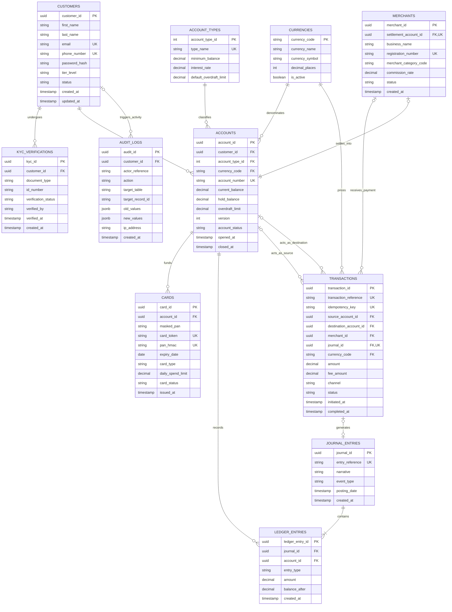

# Portfolio 1: Database Design and Modelling
## Entity-Relationship (ER) Diagram & Data Dictionary

---

### 1. Conceptual & Logical ER Diagram

The following Crow's Foot ER Diagram represents the core domain entities, their attributes, and their relational cardinalities within the **ApexBank Digital** core banking platform:

> **Image exports:** [`er_diagram.png`](er_diagram.png) (high-resolution, for documents) and [`er_diagram.svg`](er_diagram.svg) (vector). They are rendered from the Mermaid source below, which remains the single source of truth. To regenerate after editing the diagram, save the Mermaid block as `er.mmd` and run `npx @mermaid-js/mermaid-cli@11.4.2 -i er.mmd -o er_diagram.png -b white -s 3 -w 1600 -c elk.json`, where `elk.json` contains `{"layout":"elk"}`.

> **PCI DSS note:** `CARDS` intentionally has no CVV/CVC or PIN columns. The full PAN lives only in the external token vault; this database stores a masked PAN, a vault token, and a keyed HMAC fingerprint.

---

### 2. Entity Attribute Dictionary

#### 2.1 Core Entities

1. **`CUSTOMERS`**
   - `customer_id` (UUID, PK): Globally unique identifier for retail and business clients.
   - `first_name` (VARCHAR(50), NOT NULL): Legal first name of the customer.
   - `last_name` (VARCHAR(50), NOT NULL): Legal last name/surname.
   - `email` (VARCHAR(100), UNIQUE, NOT NULL): Primary email address used for identity and notifications.
   - `phone_number` (VARCHAR(20), UNIQUE, NOT NULL): International E.164 formatted phone number.
   - `password_hash` (VARCHAR(256), NOT NULL): Salted, slow password verifier (e.g. Argon2id, bcrypt or PBKDF2; the seed uses PBKDF2-SHA256 placeholders); never a plaintext password.
   - `tier_level` (VARCHAR(20), NOT NULL): Compliance tier (`TIER_1`, `TIER_2`, `TIER_3`).
   - `status` (VARCHAR(20), NOT NULL): Lifecycle state (`ACTIVE`, `SUSPENDED`, `CLOSED`).
   - `created_at`, `updated_at` (TIMESTAMPTZ, NOT NULL): Row creation and last-update timestamps.

2. **`KYC_VERIFICATIONS`**
   - `kyc_id` (UUID, PK): Unique verification event identifier.
   - `customer_id` (UUID, FK, NOT NULL): References `CUSTOMERS(customer_id)`.
   - `document_type` (VARCHAR(30), NOT NULL): `NATIONAL_ID`, `PASSPORT`, `DRIVERS_LICENSE`, or `BVN`.
   - `id_number` (VARCHAR(64), NOT NULL): Document number. Uniqueness is composite on `(document_type, id_number)`, not on `id_number` alone.
   - `verification_status` (VARCHAR(20), NOT NULL): `PENDING`, `VERIFIED`, or `REJECTED`.
   - `verified_by` (VARCHAR(50), NULLABLE): Officer or service that completed verification.
   - `verified_at` (TIMESTAMPTZ, NULLABLE): Required for `VERIFIED`, forbidden for `PENDING`.
   - `created_at` (TIMESTAMPTZ, NOT NULL): Record creation timestamp.

3. **`ACCOUNTS`**
   - `account_id` (UUID, PK): Unique internal ledger account identifier.
   - `customer_id` (UUID, FK, NOT NULL): References `CUSTOMERS(customer_id)`.
   - `account_type_id` (INT, FK, NOT NULL): References `ACCOUNT_TYPES(account_type_id)`.
   - `currency_code` (CHAR(3), FK, NOT NULL): References `CURRENCIES(currency_code)`.
   - `account_number` (VARCHAR(20), UNIQUE, NOT NULL): Customer-facing account number (10-digit NUBAN-style in the seed data).
   - `current_balance` (NUMERIC(18,4), NOT NULL, DEFAULT 0.0000): Posting-maintained settled balance.
   - `hold_balance` (NUMERIC(18,4), NOT NULL, DEFAULT 0.0000): Pending authorizations.
   - `overdraft_limit` (NUMERIC(18,4), NOT NULL, DEFAULT 0.0000): Maximum authorized negative balance (initialised from `ACCOUNT_TYPES.default_overdraft_limit`, then individually adjustable).
   - `version` (INT, NOT NULL, DEFAULT 1): Optimistic-concurrency version stamp, incremented by the application on compare-and-swap updates (see Portfolio 3).
   - `account_status` (VARCHAR(20), NOT NULL): `ACTIVE`, `DORMANT`, `FROZEN`, `CLOSED`.
   - `opened_at` (TIMESTAMPTZ, NOT NULL): Account opening timestamp.
   - `closed_at` (TIMESTAMPTZ, NULLABLE): Required when and only when `account_status = 'CLOSED'`; a closed account must have zero current and hold balances.

4. **`MERCHANTS`**
   - `merchant_id` (UUID, PK): Unique merchant identifier.
   - `settlement_account_id` (UUID, FK, UNIQUE, NOT NULL): Dedicated `ACCOUNTS` row for settlements; an account can settle at most one merchant.
   - `business_name` (VARCHAR(100), NOT NULL): Registered trading name.
   - `registration_number` (VARCHAR(50), UNIQUE, NOT NULL): Corporate registration identifier.
   - `merchant_category_code` (VARCHAR(10), NOT NULL): Industry category code.
   - `commission_rate` (NUMERIC(5,4), NOT NULL): Commission between `0.0000` and `0.1000`.
   - `status` (VARCHAR(20), NOT NULL): `ACTIVE`, `SUSPENDED`, or `INACTIVE`.
   - `created_at` (TIMESTAMPTZ, NOT NULL): Record creation timestamp.

5. **`JOURNAL_ENTRIES`**
   - `journal_id` (UUID, PK): Unique journal batch identifier.
   - `entry_reference` (VARCHAR(64), UNIQUE, NOT NULL): Unique immutable external reference.
   - `narrative` (VARCHAR(255), NOT NULL): Human-readable journal description.
   - `event_type` (VARCHAR(30), NOT NULL): `P2P_TRANSFER`, `CARD_PAYMENT`, `MERCHANT_SETTLEMENT`, `FEE_CHARGE`, `DEPOSIT`, `WITHDRAWAL`, `REVERSAL`.
   - `posting_date` (TIMESTAMPTZ, NOT NULL): Effective posting timestamp.
   - `created_at` (TIMESTAMPTZ, NOT NULL): Record creation timestamp.

6. **`LEDGER_ENTRIES`**
   - `ledger_entry_id` (UUID, PK): Individual posting row identifier.
   - `journal_id` (UUID, FK, NOT NULL): References `JOURNAL_ENTRIES(journal_id)`.
   - `account_id` (UUID, FK, NOT NULL): References `ACCOUNTS(account_id)`.
   - `entry_type` (VARCHAR(6), NOT NULL): `DEBIT` or `CREDIT`.
   - `amount` (NUMERIC(18,4), NOT NULL, CHECK > 0): Posting amount.
   - `balance_after` (NUMERIC(18,4), NOT NULL): Resulting account balance; validated by `trg_ledger_apply_balance`.
   - `created_at` (TIMESTAMPTZ, NOT NULL): Record creation timestamp.

7. **`TRANSACTIONS`**
   - `transaction_id` (UUID, PK): Unique transaction identifier.
   - `transaction_reference` (VARCHAR(64), UNIQUE, NOT NULL): External payment tracking reference.
   - `idempotency_key` (VARCHAR(128), UNIQUE, NOT NULL): Client-side key preventing double execution.
   - `source_account_id` (UUID, FK, NULLABLE): Originating account (NULL for cash deposits).
   - `destination_account_id` (UUID, FK, NULLABLE): Beneficiary account (NULL for cash withdrawals).
   - `merchant_id` (UUID, FK, NULLABLE): Merchant party for card/web payments.
   - `journal_id` (UUID, FK, UNIQUE, NULLABLE): Generated journal; one journal belongs to at most one transaction. Required for `SETTLED` and `REVERSED` transactions.
   - `currency_code` (CHAR(3), FK, NOT NULL): Must match every linked account and merchant settlement account.
   - `amount` (NUMERIC(18,4), NOT NULL, CHECK > 0): Gross principal transfer sum.
   - `fee_amount` (NUMERIC(18,4), NOT NULL, DEFAULT 0.0000): Platform fee. For P2P transfers it is charged to the payer on top of `amount`; for card payments it is the merchant commission deducted from the settlement credit (see the seed ledger comments).
   - `channel` (VARCHAR(20), NOT NULL): `MOBILE_APP`, `WEB_PORTAL`, `POS_TERMINAL`, `API_INTEGRATION`.
   - `status` (VARCHAR(20), NOT NULL): `PENDING`, `SETTLED`, `REVERSED`, `FAILED`.
   - `initiated_at` (TIMESTAMPTZ, NOT NULL): Request timestamp.
   - `completed_at` (TIMESTAMPTZ, NULLABLE): Terminal timestamp for `SETTLED`, `REVERSED`, and `FAILED`; NULL only while `PENDING`.

8. **`CARDS`**
   - `card_id` (UUID, PK): Unique card identifier.
   - `account_id` (UUID, FK, NOT NULL): Funding account for the card.
   - `masked_pan` (VARCHAR(20), NOT NULL): Truncated PAN with at most 10 digits after separators are removed; seeded values show first 6 and last 4.
   - `card_token` (VARCHAR(128), UNIQUE, NOT NULL): Opaque token issued by the PCI-scoped card vault.
   - `pan_hmac` (CHAR(64), UNIQUE, NOT NULL): Keyed HMAC-SHA-256 fingerprint of the PAN, generated with a KMS/HSM-held key.
   - `expiry_date` (DATE, NOT NULL): Card expiry date.
   - `card_type` (VARCHAR(20), NOT NULL): `DEBIT`, `VIRTUAL_DEBIT`, or `PREPAID`.
   - `daily_spend_limit` (NUMERIC(18,4), NOT NULL): Maximum authorised daily spend.
   - `card_status` (VARCHAR(20), NOT NULL): `ACTIVE`, `FROZEN`, `BLOCKED`, or `EXPIRED`.
   - `issued_at` (TIMESTAMPTZ, NOT NULL): Card issuance timestamp.
   - **PCI DSS prohibition:** there is deliberately no CVV/CVC column and no PIN column.

9. **`AUDIT_LOGS`**
   - `audit_id` (UUID, PK): Unique audit event identifier.
   - `customer_id` (UUID, FK, NULLABLE): Linked customer, set to NULL if the customer is deleted.
   - `actor_reference` (VARCHAR(100), NOT NULL): Immutable snapshot of the actor identity (customer, officer, or system service).
   - `action` (VARCHAR(50), NOT NULL): Operation performed.
   - `target_table` (VARCHAR(50), NOT NULL), `target_record_id` (VARCHAR(64), NOT NULL): The affected relation and row.
   - `old_values`, `new_values` (JSONB, NULLABLE): Before/after payloads, redacted of PAN, CVV, PIN, and secrets.
   - Rows are append-only (`trg_audit_append_only`); only the `ON DELETE SET NULL` of `customer_id` may modify them.
   - `ip_address` (VARCHAR(45), NOT NULL): Source IP address.
   - `created_at` (TIMESTAMPTZ, NOT NULL): Event timestamp.

#### 2.2 Reference Entities

1. **`CURRENCIES`**
   - `currency_code` (CHAR(3), PK): ISO 4217 currency code.
   - `currency_name` (VARCHAR(50), NOT NULL): Currency display name.
   - `currency_symbol` (VARCHAR(5), NOT NULL): Display symbol.
   - `decimal_places` (INT, NOT NULL): Minor-unit precision between 0 and 4.
   - `is_active` (BOOLEAN, NOT NULL): Whether the currency is available for new accounts.

2. **`ACCOUNT_TYPES`**
   - `account_type_id` (INT, PK): Identity-generated account type identifier.
   - `type_name` (VARCHAR(50), UNIQUE, NOT NULL): Account class name.
   - `minimum_balance` (NUMERIC(18,4), NOT NULL): Minimum required balance.
   - `interest_rate` (NUMERIC(5,4), NOT NULL): Interest rate.
   - `default_overdraft_limit` (NUMERIC(18,4), NOT NULL): Default overdraft limit for new accounts.

---

### 3. Relationship Cardinality & Business Semantics

| Parent Entity | Child Entity | Cardinality | Business Justification |
| :--- | :--- | :--- | :--- |
| **CUSTOMERS** | **ACCOUNTS** | **1 : N (One-to-Many)** | A customer may own multiple accounts (e.g., USD Savings, EUR Checking, NGN Wallet), but every account is strictly owned by one primary customer entity. |
| **CUSTOMERS** | **KYC_VERIFICATIONS** | **1 : N (One-to-Many)** | Customers progress through tiered KYC levels by submitting additional identity documents (e.g. BVN, then National ID, then passport or driver's licence). Each document is a separate verification row, and historic verifications are preserved for audit. |
| **CUSTOMERS** | **AUDIT_LOGS** | **1 : N (One-to-Many, Optional)** | A customer may trigger many audit events. `audit_logs.customer_id` is nullable and becomes NULL if the customer is deleted; `actor_reference` preserves identity. |
| **ACCOUNT_TYPES** | **ACCOUNTS** | **1 : N (One-to-Many)** | Each account is classified by exactly one account type; a type can classify many accounts. |
| **CURRENCIES** | **ACCOUNTS** | **1 : N (One-to-Many)** | Each account is denominated in exactly one currency; a currency can denominate many accounts. |
| **CURRENCIES** | **TRANSACTIONS** | **1 : N (One-to-Many)** | Each transaction has exactly one currency; a currency can price many transactions. |
| **ACCOUNTS** | **CARDS** | **1 : N (One-to-Many)** | A single checking account can have one primary physical debit card and several virtual disposable shopping cards. |
| **ACCOUNTS** | **LEDGER_ENTRIES** | **1 : N (One-to-Many)** | An account accumulates thousands of debit and credit postings over its lifecycle; each entry belongs to exactly one account. |
| **ACCOUNTS** | **TRANSACTIONS** | **1 : N (One-to-Many, Optional source)** | An account can originate many transactions; a transaction may have no source account (cash deposit). |
| **ACCOUNTS** | **TRANSACTIONS** | **1 : N (One-to-Many, Optional destination)** | An account can receive many transactions; a transaction may have no destination account (cash withdrawal). |
| **MERCHANTS** | **TRANSACTIONS** | **1 : N (One-to-Many, Optional)** | A merchant can receive many payments; a transaction may have no merchant (P2P transfer). |
| **MERCHANTS** | **ACCOUNTS** | **1 : 1 (One-to-One, Optional on account side)** | Every merchant must designate exactly one dedicated settlement account; an account can settle for at most one merchant. |
| **JOURNAL_ENTRIES** | **LEDGER_ENTRIES** | **1 : N (One-to-Many, Min 2)** | Double-entry invariant: Every journal header must link to at least two ledger entry lines, all in one currency, whose DEBIT and CREDIT sums are equal. Crow's foot can only show "one or more"; the minimum of two is enforced by `trg_ledger_balanced`. |
| **TRANSACTIONS** | **JOURNAL_ENTRIES** | **1 : 1 (One-to-One, Optional)** | A transaction may generate at most one journal (mandatory once `SETTLED` or `REVERSED`); a journal may exist without a transaction (for example, a standalone fee journal). |

