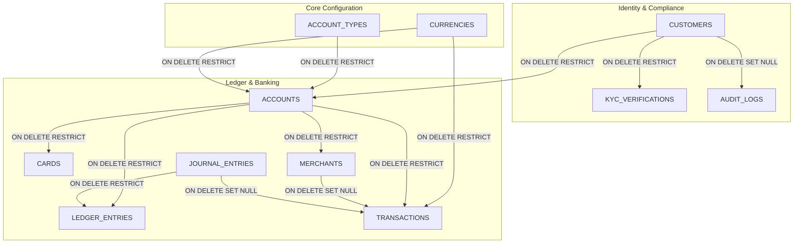

# Portfolio 1: Database Design and Modelling
## Relational Schema, Keys, and Integrity Constraints

---

### 1. Formal Relational Schema Notation

The relational database model for **ApexBank Digital** is formally specified using relational calculus notation: $\text{Relation}(\underline{\text{PrimaryKey}}, \text{Attribute}_1, \dots, \text{ForeignKey}^*)$. Primary keys are underlined, and foreign keys are denoted with asterisks ($^*$). The physical implementation targets **PostgreSQL 16** and uses native `UUID`, `NUMERIC(18,4)`, `TIMESTAMPTZ`, and `JSONB` types.

1. **`CURRENCIES`**  
   $\text{CURRENCIES}(\underline{\text{currency\_code}}, \text{currency\_name}, \text{currency\_symbol}, \text{decimal\_places}, \text{is\_active})$

2. **`ACCOUNT_TYPES`**  
   $\text{ACCOUNT\_TYPES}(\underline{\text{account\_type\_id}}, \text{type\_name}, \text{minimum\_balance}, \text{interest\_rate}, \text{default\_overdraft\_limit})$

3. **`CUSTOMERS`**  
   $\text{CUSTOMERS}(\underline{\text{customer\_id}}, \text{first\_name}, \text{last\_name}, \text{email}, \text{phone\_number}, \text{password\_hash}, \text{tier\_level}, \text{status}, \text{created\_at}, \text{updated\_at})$

4. **`KYC_VERIFICATIONS`**  
   $\text{KYC\_VERIFICATIONS}(\underline{\text{kyc\_id}}, \text{customer\_id}^*, \text{document\_type}, \text{id\_number}, \text{verification\_status}, \text{verified\_by}, \text{verified\_at}, \text{created\_at})$  
   *Foreign Key:* $\text{customer\_id}^* \rightarrow \text{CUSTOMERS}(\text{customer\_id})$

5. **`ACCOUNTS`**  
   $\text{ACCOUNTS}(\underline{\text{account\_id}}, \text{customer\_id}^*, \text{account\_type\_id}^*, \text{currency\_code}^*, \text{account\_number}, \text{current\_balance}, \text{hold\_balance}, \text{overdraft\_limit}, \text{version}, \text{account\_status}, \text{opened\_at}, \text{closed\_at})$  
   *Foreign Keys:*  
   - $\text{customer\_id}^* \rightarrow \text{CUSTOMERS}(\text{customer\_id})$  
   - $\text{account\_type\_id}^* \rightarrow \text{ACCOUNT\_TYPES}(\text{account\_type\_id})$  
   - $\text{currency\_code}^* \rightarrow \text{CURRENCIES}(\text{currency\_code})$

6. **`MERCHANTS`**  
   $\text{MERCHANTS}(\underline{\text{merchant\_id}}, \text{settlement\_account\_id}^*, \text{business\_name}, \text{registration\_number}, \text{merchant\_category\_code}, \text{commission\_rate}, \text{status}, \text{created\_at})$  
   *Foreign Key:* $\text{settlement\_account\_id}^* \rightarrow \text{ACCOUNTS}(\text{account\_id})$

7. **`JOURNAL_ENTRIES`**  
   $\text{JOURNAL\_ENTRIES}(\underline{\text{journal\_id}}, \text{entry\_reference}, \text{narrative}, \text{event\_type}, \text{posting\_date}, \text{created\_at})$

8. **`LEDGER_ENTRIES`**  
   $\text{LEDGER\_ENTRIES}(\underline{\text{ledger\_entry\_id}}, \text{journal\_id}^*, \text{account\_id}^*, \text{entry\_type}, \text{amount}, \text{balance\_after}, \text{created\_at})$  
   *Foreign Keys:*  
   - $\text{journal\_id}^* \rightarrow \text{JOURNAL\_ENTRIES}(\text{journal\_id})$  
   - $\text{account\_id}^* \rightarrow \text{ACCOUNTS}(\text{account\_id})$

9. **`TRANSACTIONS`**  
   $\text{TRANSACTIONS}(\underline{\text{transaction\_id}}, \text{transaction\_reference}, \text{idempotency\_key}, \text{source\_account\_id}^*, \text{destination\_account\_id}^*, \text{merchant\_id}^*, \text{journal\_id}^*, \text{currency\_code}^*, \text{amount}, \text{fee\_amount}, \text{channel}, \text{status}, \text{initiated\_at}, \text{completed\_at})$  
   *Foreign Keys:*  
   - $\text{source\_account\_id}^* \rightarrow \text{ACCOUNTS}(\text{account\_id})$  
   - $\text{destination\_account\_id}^* \rightarrow \text{ACCOUNTS}(\text{account\_id})$  
   - $\text{merchant\_id}^* \rightarrow \text{MERCHANTS}(\text{merchant\_id})$  
   - $\text{journal\_id}^* \rightarrow \text{JOURNAL\_ENTRIES}(\text{journal\_id})$  
   - $\text{currency\_code}^* \rightarrow \text{CURRENCIES}(\text{currency\_code})$

10. **`CARDS`**  
    $\text{CARDS}(\underline{\text{card\_id}}, \text{account\_id}^*, \text{masked\_pan}, \text{card\_token}, \text{pan\_hmac}, \text{expiry\_date}, \text{card\_type}, \text{daily\_spend\_limit}, \text{card\_status}, \text{issued\_at})$  
    *Foreign Key:* $\text{account\_id}^* \rightarrow \text{ACCOUNTS}(\text{account\_id})$  
    *PCI DSS:* no CVV/CVC or PIN attributes exist. The full PAN is held only in an external token vault; `card_token` references it, `pan_hmac` is a keyed HMAC-SHA-256 fingerprint, and `masked_pan` is truncated.

11. **`AUDIT_LOGS`**  
    $\text{AUDIT\_LOGS}(\underline{\text{audit\_id}}, \text{customer\_id}^*, \text{actor\_reference}, \text{action}, \text{target\_table}, \text{target\_record\_id}, \text{old\_values}, \text{new\_values}, \text{ip\_address}, \text{created\_at})$  
    *Foreign Key:* $\text{customer\_id}^* \rightarrow \text{CUSTOMERS}(\text{customer\_id})$  
    *Audit integrity:* `actor_reference` is an immutable identity snapshot; it remains populated even when `customer_id` is set to NULL on deletion.

---

### 2. Candidate Keys & Alternate Keys

In addition to Primary Keys, the following candidate keys enforce uniqueness across business identifiers:

| Table | Candidate / Alternate Key | Enforcement Constraint | Business Purpose |
| :--- | :--- | :--- | :--- |
| **CUSTOMERS** | `email` | `UNIQUE` | Prevents duplicate user registrations under one email address. |
| **CUSTOMERS** | `phone_number` | `UNIQUE` | Ensures phone numbers uniquely route OTP and SMS notifications. |
| **KYC_VERIFICATIONS** | `(document_type, id_number)` | `UNIQUE (composite)` | Prevents duplicate registration of the same national ID or passport. |
| **ACCOUNTS** | `account_number` | `UNIQUE` | Customer-facing account number (10-digit NUBAN-style in the seed data; `VARCHAR(20)` allows longer formats). |
| **ACCOUNT_TYPES** | `type_name` | `UNIQUE` | Guarantees account class names are not duplicated in the system. |
| **JOURNAL_ENTRIES** | `entry_reference` | `UNIQUE` | External settlement reference guaranteeing idempotency. |
| **TRANSACTIONS** | `transaction_reference` | `UNIQUE` | Unique payment tracking reference shared with clients and clearing. |
| **TRANSACTIONS** | `idempotency_key` | `UNIQUE` | Protects against network duplicate retry requests. |
| **TRANSACTIONS** | `journal_id` | `UNIQUE` | Ensures a journal is linked to at most one customer-facing transaction. |
| **CARDS** | `card_token` | `UNIQUE` | Opaque vault token that prevents duplicate card issuance without storing the PAN. |
| **CARDS** | `pan_hmac` | `UNIQUE` | Keyed HMAC-SHA-256 fingerprint used for duplicate detection without reversible plain hashing. |
| **MERCHANTS** | `registration_number` | `UNIQUE` | Corporate affairs tax / registration number. |
| **MERCHANTS** | `settlement_account_id` | `UNIQUE` | Ensures one dedicated settlement account serves at most one merchant. |

---

### 3. Comprehensive Integrity Constraints Specification

#### 3.1 Entity & Referential Integrity Matrix



`TRANSACTIONS` references `ACCOUNTS` twice: `source_account_id` and `destination_account_id`, both `ON DELETE RESTRICT`.

#### 3.2 Semantic Business Check Constraints

All checks below are declared inline in [`ddl_schema.sql`](ddl_schema.sql), so they are created atomically with each table:

1. **Overdraft-Bounded Balance Invariant (Anti-Overdraft Breach):**
   ```sql
   CONSTRAINT chk_account_solvency CHECK (current_balance >= -overdraft_limit)
   ```

2. **Non-Negative Overdraft Limit:**
   ```sql
   CONSTRAINT chk_account_overdraft CHECK (overdraft_limit >= 0.0000)
   ```

3. **Hold Balance Integrity:**
   ```sql
   CONSTRAINT chk_account_holds CHECK (
       hold_balance >= 0.0000
       AND hold_balance <= (current_balance + overdraft_limit)
   )
   ```

4. **Transaction Amount Positivity:**
   ```sql
   -- inline column checks on transactions (system-named)
   amount NUMERIC(18, 4) NOT NULL CHECK (amount > 0.0000)
   fee_amount NUMERIC(18, 4) NOT NULL DEFAULT 0.0000 CHECK (fee_amount >= 0.0000)
   ```

5. **Ledger Posting Type Domain:**
   ```sql
   CHECK (entry_type IN ('DEBIT', 'CREDIT'))
   ```

6. **Transaction Party and Self-Transfer Constraints:**
   ```sql
   CONSTRAINT chk_txn_party_present CHECK (
       source_account_id IS NOT NULL
       OR destination_account_id IS NOT NULL
       OR merchant_id IS NOT NULL
   )
   CONSTRAINT chk_no_self_transfer CHECK (
       source_account_id IS NULL
       OR destination_account_id IS NULL
       OR source_account_id <> destination_account_id
   )
   ```

7. **Card Data Constraints (PCI DSS):**
   ```sql
   CONSTRAINT chk_masked_pan_not_full CHECK (
       length(regexp_replace(masked_pan, '[^0-9]', '', 'g')) <= 10
   )
   CONSTRAINT chk_pan_hmac_format CHECK (pan_hmac ~ '^[0-9a-f]{64}$')
   ```

8. **Lifecycle Timestamp Consistency:**
   ```sql
   CONSTRAINT chk_kyc_pending_has_no_verified_at CHECK (
       verification_status <> 'PENDING' OR verified_at IS NULL
   )
   CONSTRAINT chk_kyc_verified_has_timestamp CHECK (
       verification_status <> 'VERIFIED' OR verified_at IS NOT NULL
   )
   CONSTRAINT chk_account_closed_at CHECK (
       (account_status = 'CLOSED') = (closed_at IS NOT NULL)
   )
   CONSTRAINT chk_txn_completed_at CHECK (
       (status = 'PENDING') = (completed_at IS NULL)
   )
   ```

   `completed_at` is the terminal timestamp for `SETTLED`, `REVERSED`, and `FAILED`; only `PENDING` transactions may omit it.

9. **Posted Transactions and Closed Accounts:**
   ```sql
   CONSTRAINT chk_txn_posted_has_journal CHECK (
       status NOT IN ('SETTLED', 'REVERSED') OR journal_id IS NOT NULL
   )
   CONSTRAINT chk_account_closed_zero_balance CHECK (
       account_status <> 'CLOSED'
       OR (current_balance = 0.0000 AND hold_balance = 0.0000)
   )
   ```

#### 3.3 PostgreSQL Integrity Triggers

Cross-row invariants cannot be expressed as simple `CHECK` constraints. They are enforced with PL/pgSQL triggers:

1. **Append-only financial history:** `trg_journal_append_only` and `trg_ledger_append_only` raise an exception on any `UPDATE` or `DELETE` against `journal_entries` or `ledger_entries`.
2. **Deferred double-entry enforcement:** `trg_ledger_balanced` is a `DEFERRABLE INITIALLY DEFERRED` constraint trigger. At commit it verifies that every journal has at least two lines, that all lines post to accounts of a single currency, and that `SUM(DEBIT) = SUM(CREDIT)`.
3. **No empty journals:** `trg_journal_has_lines` is a deferred constraint trigger that rejects a journal committed without ledger lines.
4. **Posting-maintained balances:** `trg_ledger_apply_balance` applies each debit/credit to `accounts.current_balance`, rejects an unknown account, and raises an exception when `balance_after` does not match the resulting balance. The `UPDATE ... RETURNING` takes a row lock on the account, so concurrent postings to the same account are serialised and a stale client-computed `balance_after` is rejected rather than silently overwritten. Direct `UPDATE`s of `current_balance` are not blocked at the database level (Portfolio 3 uses them to demonstrate concurrency anomalies); in production they would be revoked from application roles.
5. **Currency consistency:** `trg_transaction_currency_guard` rejects transactions whose currency differs from any linked source account, destination account, or merchant settlement account.
6. **Append-only audit trail:** `trg_audit_append_only` rejects `UPDATE` and `DELETE` on `audit_logs`. The single permitted update is the `ON DELETE SET NULL` action of `fk_audit_customer`, which nulls `customer_id` and changes nothing else.
7. **Automatic timestamp maintenance:** `trg_customers_updated_at` refreshes `customers.updated_at` on every update.

#### 3.4 PCI DSS Card-Data Design

PCI DSS v4.0 Requirement 3.3.1 prohibits storing sensitive authentication data (including CVV/CVC and PIN) after authorisation, even if encrypted. Accordingly, the `cards` table deliberately omits `encrypted_cvv` and any PIN column. It stores only:

- `masked_pan`, constrained so that stripping separators leaves no more than 10 digits (first 6 plus last 4, the maximum permitted by Requirement 3.4.1);
- `card_token`, an opaque reference to the PCI-scoped vault (index tokens are an accepted way to render PAN unreadable under Requirement 3.5.1);
- `pan_hmac`, a keyed HMAC-SHA-256 fingerprint generated with a KMS/HSM-held key (Requirement 3.5.1.1 requires hashes of PAN to be keyed).

Because a truncated PAN and a hash of the same PAN co-exist, PCI DSS requires controls that prevent them being correlated to reconstruct the PAN; the secret HMAC key is that control. The check constraint limits the number of digits but does not prove which digits are shown; that is the responsibility of the issuing service.

A plain SHA-256 hash of a PAN is not used because the PAN search space is small enough to permit offline brute-force attacks.

